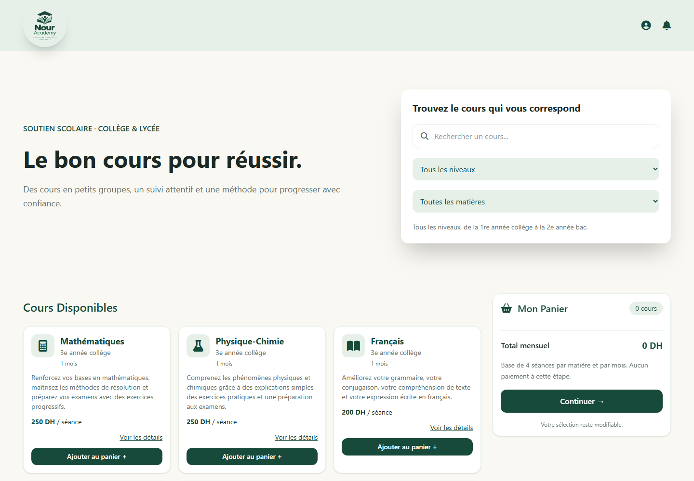
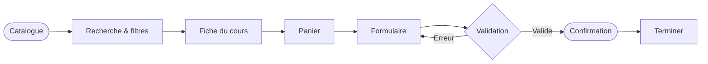
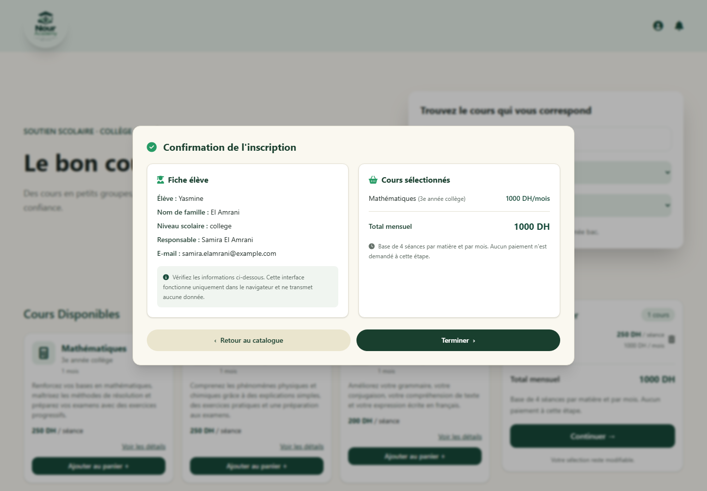

<div align="center">


<h1>Nour Academy</h1>

<p><strong>Le bon cours pour réussir.</strong></p>

<p>Portail d'inscription frontend pour le soutien scolaire, du collège au lycée.</p>

<p>
  <a href="https://hsassouma.github.io/Nour-Academy-Portail-d-inscription/">
    
  </a>
  
  
</p>

<p>
  
  
  
  
  
</p>

</div>

<div align="center">
  
  <sub>Catalogue, filtres et panier — aperçu réel de l'application.</sub>
</div>

---

## Le projet

**Nour Academy** accompagne les élèves du collège et du lycée dans leur progression scolaire. Le portail a été pensé pour rendre l'inscription simple et lisible : trouver le cours adapté, comprendre le programme et le tarif, composer une sélection, puis vérifier sa demande avant de terminer.

Le parcours est **100 % frontend** : le catalogue est chargé depuis un fichier JSON local, les calculs et la validation se font dans le navigateur, et aucune donnée personnelle n'est transmise à un serveur.

> [!NOTE]
> Ce projet est une démonstration frontend complète. Il ne contient ni API, ni base de données, ni stockage des inscriptions.

## Le parcours en un coup d'œil



Chaque étape reste dans la même page : les modales, le panier et le récapitulatif sont gérés en JavaScript, sans rechargement.

## Fonctionnalités

| Module | Ce que fait l'application |
| :--- | :--- |
| **Catalogue** | Affiche **30 cours** répartis sur 4 niveaux, avec matière, description, durée, tarif par séance et tarif mensuel. |
| **Recherche & filtres** | Filtre les cours par niveau et par matière, avec une recherche instantanée par matière. Les critères se combinent. |
| **Fiche cours** | Ouvre une fiche détaillée avec le programme, la durée, le prix par séance et le prix mensuel calculé sur 4 séances. |
| **Panier** | Ajout d'un cours, blocage des doublons, suppression d'un cours, compteur et total mensuel recalculés automatiquement. |
| **Formulaire** | Saisie du responsable, de l'élève, du niveau scolaire, du mot de passe et du consentement. |
| **Validation** | Contrôle des noms (accents acceptés), de l'e-mail, du niveau, de la robustesse du mot de passe, de la confirmation et du consentement. |
| **Confirmation** | Popup récapitulative avec la fiche élève, le responsable, les cours sélectionnés et le total mensuel. |
| **Expérience locale** | Aucune donnée d'inscription n'est envoyée. Le bouton **Terminer** ferme le récapitulatif, vide le panier et réinitialise le formulaire. |
| **Responsive** | Mise en page adaptée au mobile et au desktop, avec un panier fixe en bas de l'écran sur petits écrans. |

<div align="center">
  
  <sub>Récapitulatif de la demande — fiche élève, cours et total mensuel.</sub>
</div>

## Stack technique

| Technologie | Rôle dans le projet |
| :--- | :--- |
| **HTML5** | Structure sémantique de la page, des formulaires et des modales. |
| **JavaScript — ES Modules** | État du panier, rendu dynamique du catalogue, filtres, validation et confirmation. |
| **Tailwind CSS 4** | Design responsive, palette, espacements, composants et états interactifs. |
| **Vite 8** | Serveur de développement, compilation de production et rechargement à chaud. |
| **Font Awesome 6** | Icônes de l'interface (catalogue, panier, formulaire). |
| **JSON** | Catalogue local `src/courses.json` chargé dynamiquement par le frontend. |
| **GitHub Actions + Pages** | Compilation et publication automatique du dossier `dist` sur GitHub Pages. |

**Prérequis :** Node.js `20.19+` ou `22.12+`, npm.

## Structure du projet

```text
.
├── .github/
│   └── workflows/
│       └── deploy.yml            # Build et déploiement GitHub Pages
├── docs/
│   ├── apercu-desktop.png        # Aperçu du catalogue
│   └── apercu-confirmation.png   # Aperçu de la confirmation
├── src/
│   ├── assets/
│   │   └── logo.png              # Identité visuelle
│   ├── courses.json              # Catalogue : 30 cours, 4 niveaux
│   ├── functions.js              # Catalogue, panier, validation, confirmation
│   ├── main.js                   # Initialisation et écouteurs d'événements
│   └── style.css                 # Point d'entrée Tailwind
├── .gitignore
├── index.html                    # Structure de l'application
├── package.json
├── package-lock.json
├── vite.config.js                # Base GitHub Pages + plugin Tailwind
└── README.md
```

Le dossier `dist/` est généré par `npm run build` et n'est pas versionné.

## Démarrage rapide

```bash
git clone https://github.com/HSassouma/Nour-Academy-Portail-d-inscription.git
cd Nour-Academy-Portail-d-inscription
npm install
npm run dev
```

Ouvrir ensuite :

```text
http://localhost:5173/Nour-Academy-Portail-d-inscription/
```

### Scripts disponibles

| Commande | Description |
| :--- | :--- |
| `npm run dev` | Lance le serveur de développement Vite avec rechargement à chaud. |
| `npm run build` | Génère la version de production dans `dist/`. |
| `npm run preview` | Prévisualise localement le build de production. |

## Données et confidentialité

- Le catalogue est chargé depuis `src/courses.json` ; il n'y a ni API ni base de données.
- Les informations saisies restent en mémoire dans la page et disparaissent au rechargement.
- Le total mensuel correspond à `prix de la séance × 4`.
- Aucun paiement n'est demandé et aucune inscription n'est enregistrée.

## Déploiement

Le workflow [`.github/workflows/deploy.yml`](.github/workflows/deploy.yml) se déclenche à chaque push sur `main`. Il installe les dépendances, compile le projet avec Vite, puis publie `dist` sur GitHub Pages.

La démo en ligne est disponible ici : **[Nour Academy — Portail d'inscription](https://hsassouma.github.io/Nour-Academy-Portail-d-inscription/)**.

## Choix techniques

| Choix | Pourquoi |
| :--- | :--- |
| **Aucun framework JS** | Le parcours reste léger, direct et facile à comprendre avec le DOM natif. |
| **Catalogue JSON** | Les cours peuvent être mis à jour sans modifier la logique d'affichage. |
| **Tailwind CSS** | Permet de construire rapidement une interface responsive et cohérente. |
| **Vite** | Démarrage instantané, build optimisé et intégration simple avec Tailwind. |
| **Frontend uniquement** | Déploiement statique immédiat sur GitHub Pages, sans serveur à maintenir. |

---

<div align="center">
  <sub>Nour Academy · Portail d'inscription · Conçu pour rendre le parcours plus simple.</sub>
</div>
